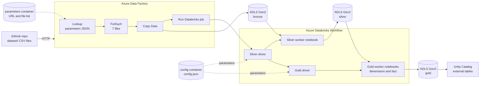

# AdventureWorks Medallion Pipeline on Azure

An end-to-end, config-driven data pipeline on Azure. **Azure Data Factory** ingests the AdventureWorks CSV files from GitHub into **ADLS Gen2**, and **Azure Databricks** transforms them through **silver** and **gold** layers into a star schema stored as Delta tables and exposed through **Unity Catalog**. The whole flow runs from a single manual trigger in ADF.

## Architecture



## Tech stack

| Area | Tools |
|---|---|
| Ingestion and orchestration | Azure Data Factory (Lookup, ForEach, Copy Data, Databricks Job activity) |
| Storage | Azure Data Lake Storage Gen2 (bronze, silver, gold, config, parameters containers) |
| Processing | Azure Databricks, PySpark, Spark SQL |
| Table format and governance | Delta Lake, Unity Catalog (external tables) |
| Security | Access Connector for Azure Databricks, managed identities (no stored secrets) |
| Source control | GitHub, ADF Git integration, Databricks Git folders |

## Dataset

The AdventureWorks dataset, 7 CSV files stored in the `dataset/` folder of this repo:

- Calendar
- Customers
- Products
- Product Categories
- Product Subcategories
- Sales
- Territories

## How it works

### 1. Ingestion: Azure Data Factory
- A JSON file in the `parameters` container lists the **relative URL** and **file name** for each CSV.
- A **Lookup** activity reads that file and passes the list to a **ForEach** loop.
- Inside the loop, a **Copy Data** activity pulls each file from GitHub over HTTP and writes it to the **bronze** container. The sink file name comes from the JSON, so each run overwrites the same files instead of duplicating them.
- After the copy succeeds, ADF triggers the Databricks job and waits for it to finish.

### 2. Silver layer: cleaning and standardizing
- A **silver driver notebook** reads its parameters from `config.json` in the `config` container and runs the silver worker notebook.
- The **worker notebook** holds the cleaning and transformation logic. Its inputs (bronze path, silver folder name) are `dbutils.widgets`, filled in by the driver from the config file.
- Output is written as Delta to the **silver** container.

### 3. Gold layer: star schema
- A **gold driver notebook** reads its parameters from the config container and runs **7 worker notebooks**: the dimension notebooks and the sales fact notebook.
- Output is written as Delta to the **gold** container.
- Tables are created in **Unity Catalog** as external tables over the Delta paths, so they can be queried with SQL.

### 4. Orchestration
- A **Databricks Workflow** runs `silver driver -> gold driver`. Gold only runs if silver succeeds.
- The ADF pipeline chains the whole flow: `Lookup -> ForEach(Copy) -> Databricks job`, started with one **Trigger now**.

## Data model (gold)

> Replace this table with your actual gold tables.

| Table | Type | Description |
|---|---|---|
| `dim_calendar` | Dimension | Date attributes |
| `dim_customers` | Dimension | Customer attributes |
| `dim_products` | Dimension | Products with category and subcategory |
| `dim_territories` | Dimension | Sales territories |
| `fact_sales` | Fact | Sales transactions linked to the dimensions |

## Design decisions

- **Config-driven.** File lists, paths and folder names live in JSON files in storage, not in code. Adding a file or changing a path means editing config, not notebooks.
- **Driver and worker pattern.** Workers hold transformation logic, and drivers handle parameters and execution. Each layer is easy to test and extend.
- **No stored secrets.** Databricks reaches ADLS through an Access Connector with a managed identity and Unity Catalog external locations. ADF uses its managed identity. No keys, SAS tokens or client secrets exist in the repo.
- **External tables.** Data stays in ADLS as Delta, and Unity Catalog adds governance and SQL access on top.
- **Overwrite loads.** Each run rewrites the files and tables, so reruns are idempotent. This is simple and right for a small static dataset.

## Repository structure

```
.
├── dataset/              # Source AdventureWorks CSV files
├── adf/                  # ADF pipelines, datasets, linked services (JSON)
├── databricks/
│   ├── silver/           # Silver driver and worker notebooks
│   ├── gold/             # Gold driver and worker notebooks
│   └── job.json          # Databricks Workflow definition
├── config/
│   └── config.sample.json
├── docs/                 # Screenshots
└── README.md
```

## Screenshots

> Add images to `docs/` and reference them here.

- ADF pipeline canvas
- ADF Monitor: successful run
- Databricks Workflow DAG
- Sample query on a gold table

## How to run

1. Create ADLS Gen2 containers: `bronze`, `silver`, `gold`, `config`, `parameters`.
2. Upload the parameters JSON to `parameters` and the config JSON to `config` (see `config/config.sample.json`).
3. Set up Unity Catalog: Access Connector, storage credential and external locations for silver and gold.
4. Import the Databricks notebooks and create the Workflow (silver driver, then gold driver).
5. Import the ADF pipeline, link it to your workspace and trigger it.

## Future improvements

- Incremental loads with Delta `MERGE` instead of full overwrite
- Data quality checks between layers
- CI/CD for ADF and Databricks (GitHub Actions)
- Job cluster or serverless compute to cut cost
- A Power BI dashboard on the gold layer
